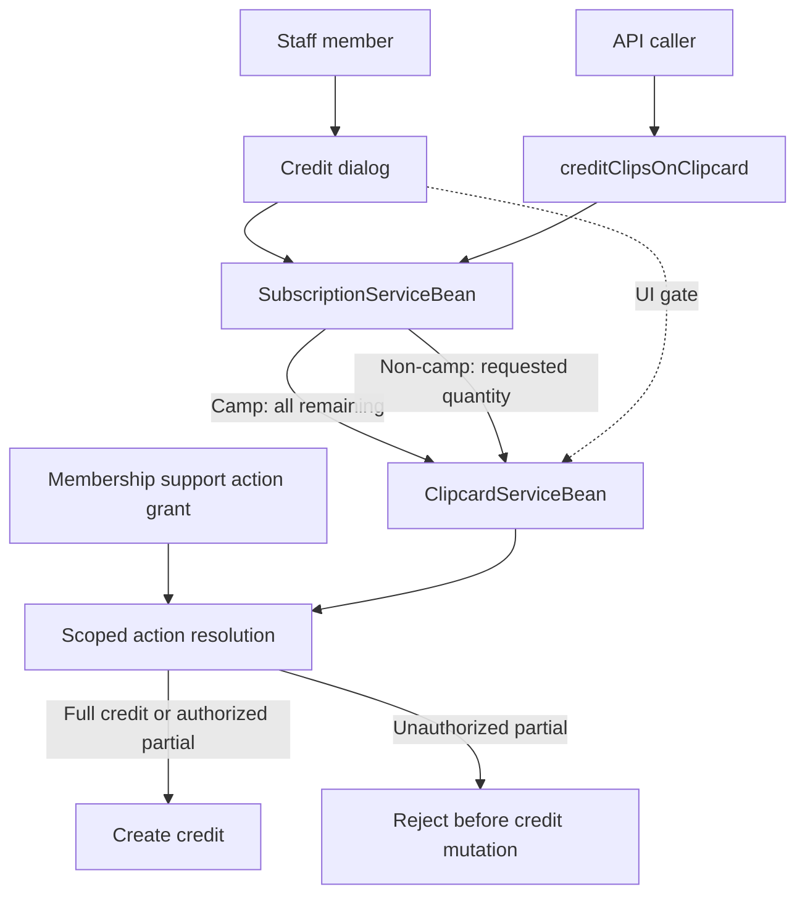

# DEV-76818 Clip Credit Quantity Permission - Plan

## Goal Capsule

- **Objective:** Staff permissions determine whether a clip card credit can refund a selected quantity or must refund all remaining clips.
- **Means:** Add a distinct action and enforce it in the dialog and the server credit path (KTD1, KTD2).
- **Product authority:** DEV-76818 and its linked customer request ST-17069.
- **Execution profile:** Java 8 multi-module Gradle monorepo; staff client, server service, API, action catalog, role configuration, and behavior tests.
- **Stop conditions:** Stop if a unique action ID cannot be reserved; do not ship partial-credit enforcement without server-side authorization.

## Product Contract

### Summary

Introduce a staff action that controls partial clip card credits. Staff without the action can credit only all remaining clips; staff with it may select a smaller quantity for non-camp clipcards.

### Problem Frame

Release 858 enabled staff to choose how many clips to credit from a clip card. GoodLife raised that club associates should not have this flexibility, while other staff may need it. The requested control is through staff roles/profiles.

### Requirements

**Permission and staff experience**

- R1. Introduce a distinct staff action that permits selecting a partial clip quantity when crediting a clip card.
- R2. Staff with the action can edit the quantity for non-camp clipcards and select a valid quantity from one through the remaining clip count.
- R3. Staff without the action see the quantity selector disabled at the remaining count and can credit only the full remaining clip count.
- R4. Retain the existing `BUYOUT_CLIPCARD` action as the permission to credit clip cards; the new action governs partial quantity selection.
- R5. Retain `OVERRIDE_BUYOUT_CLIPCARD` for overriding the buyout fee. It is currently presented as “Override clipcard buyout fee” and enforced for a non-zero override (`common-base/src/main/java/dk/procard/eclub/base/Actions.java`, `plugin-localization/src/main/resources/dk/procard/eclub/person/Bundle.properties`, `server-core-impl/src/main/java/com/exerp/clublead/server/subscription/ClipcardServiceBean.java`).

**Role assignment and service access**

- R6. Do not automatically grant the new action to roles/profiles that currently have `BUYOUT_CLIPCARD`; configure it separately for staff who need partial credits.
- R7. Associate the new action with the Membership support role, as requested in DEV-76818.
- R8. Enforce the quantity permission on the server so callers without it cannot credit fewer than the remaining clips, including API callers.
- R9. API callers with the new action may request a partial credit for a non-camp clipcard; callers without it may request only the remaining quantity.
- R10. Camp clipcards remain full-credit only, regardless of the caller's partial-credit action.

### Actors

- A1. Staff member performing a clip card credit, whose available actions determine whether partial quantity selection is permitted.
- A2. API caller initiating a clip card credit, subject to the same quantity permission.
- A3. Staff administrator configuring staff role/profile actions.

### Key Flows

- F1. **Staff credit with permission:** Staff opens the clip credit dialog, chooses a quantity no greater than the remaining clips on a non-camp clipcard, and completes the credit. Covers R1, R2, R8.
- F2. **Staff credit without permission:** Staff opens the dialog with the quantity fixed at all remaining clips and completes a full credit. Covers R3, R8.
- F3. **API credit:** The service checks the caller's action before accepting a requested partial quantity; full remaining quantity is accepted without the partial-credit action. Camp clipcards retain full-credit behavior. Covers R8, R9, R10.
- F4. **Role configuration:** The action is configured separately from `BUYOUT_CLIPCARD` and associated with Membership support. Covers R6, R7.

### Acceptance Examples

- AE1. **Given** a staff member with the new action and a non-camp clipcard with remaining clips, **when** the member selects a quantity from 1 through the remaining count, **then** the credit uses that quantity. Covers R2.
- AE2. **Given** a staff member without the new action, **when** the member opens the credit dialog, **then** the quantity is disabled at the remaining count and only a full remaining-clip credit is possible. Covers R3, R8.
- AE3. **Given** an API caller without the new action, **when** the caller requests fewer than the remaining clips on a non-camp clipcard, **then** the credit is rejected; a request for all remaining clips remains allowed. Covers R8, R9.
- AE4. **Given** a role/profile that has `BUYOUT_CLIPCARD`, **when** the new action is introduced, **then** it is not granted automatically. Covers R6.
- AE5. **Given** staff in the Membership support role, **when** that role is configured, **then** it has the new action as requested in DEV-76818. Covers R7.
- AE6. **Given** a staff member with permission to credit clip cards but without `OVERRIDE_BUYOUT_CLIPCARD`, **when** the member credits a clip card, **then** the quantity permission does not grant buyout fee override capability. Covers R4, R5.
- AE7. **Given** a camp clipcard with remaining clips and a caller with the new action, **when** the caller requests a partial quantity, **then** the credit uses all remaining clips. Covers R10.

### Scope Boundaries

- **Included:** Staff action definition, quantity selector behavior, server-side enforcement, API authorization for partial quantities, and separate role configuration without automatic inheritance from `BUYOUT_CLIPCARD`.
- **Outside this product's identity:** Changing buyout fee override behavior, credit valuation, payout behavior, or the general permission to credit a clip card.

### Key Decisions

- K1. **Separate quantity authority from fee override.** Use a new staff action because `OVERRIDE_BUYOUT_CLIPCARD` already controls price override in the client dialog and server service; combining the permissions would grant unrelated capability. Governs R4, R5.
- K2. **Keep partial-credit permission opt-in.** Do not automatically grant the new action to roles/profiles that currently have `BUYOUT_CLIPCARD`; associate it with Membership support as requested in DEV-76818. Governs R6, R7.
- K3. **Preserve full-credit camp behavior.** Camp clipcards continue to credit all remaining clips, even when the caller has the new action. This preserves the existing server behavior and the user-confirmed scope (session-settled: user-directed — chosen over partial camp credits: preserves current behavior). Governs R2, R9, R10.

### Success Criteria

- Staff without the action cannot perform a partial non-camp clip credit through either the staff interface or API.
- Staff with the action can select and credit a valid partial quantity on a non-camp clipcard.
- Camp clipcards continue to credit all remaining clips.
- Existing clip credit and buyout fee override permissions retain their separate meanings.

### Sources / Research

- Jira DEV-76818: acceptance criteria require a new staff action, disabled quantity field for staff without the action, full remaining-clip credit for those staff, role/profile assignment, server-side implementation, and API support.
- Linked Jira ST-17069: GoodLife requested that club associates not have access to selecting the number of clips credited.
- Jira comments: estimate requested and given as Small (up to 5 days); approval was recorded and the issue was moved to backlog. These comments do not alter the stated acceptance criteria.
- `client/src/main/java/dk/procard/eclub/subscription/clipcards/BuyoutClipcardDialog.java`: the quantity field is currently shown and constrained to the range from one through clips remaining; `OVERRIDE_BUYOUT_CLIPCARD` is wired to the buyout fee field.
- `client/src/main/java/dk/procard/eclub/subscription/clipcards/BuyoutClipcardController.java`: initializes selected quantity to clips remaining and passes the selected amount onward.
- `server-core-impl/src/main/java/com/exerp/clublead/server/subscription/ClipcardServiceBean.java`: `OVERRIDE_BUYOUT_CLIPCARD` is checked when a non-zero buyout fee override is provided.
- `server-core-impl/src/main/java/com/exerp/clublead/server/subscription/SubscriptionServiceBean.java`: camp clipcards are converted to full remaining quantity regardless of requested quantity; non-camp clipcards use the requested quantity when present.
- `server-core-impl/src/main/java/dk/procard/eclub/gl/api/APIServiceBean.java`: API operation `creditClipsOnClipcard` accepts optional `numberOfClipsToCredit`, validates it against remaining clips, and forwards it for crediting. The inspected operation does not show a partial-quantity action check.
- `common-base/src/main/java/dk/procard/eclub/base/Actions.java` and `common-base/src/main/java/dk/procard/eclub/base/Roles.java`: actions and built-in role grants are code-defined. The action catalog documents that new actions also need a database upgrade script and unique ID reservation.
- `test-behaviour/src/main/resources/com/exerp/clublead/cucumber/capabilities/clipcard/credit_clipcard.feature`: existing behavior scenarios cover selected quantities and credit amounts.
- `test-behaviour/src/main/resources/com/exerp/clublead/cucumber/rest_api/v6/clipcard_api/creditClipsOnClipcard.feature`: existing REST scenarios cover full credits, requested quantities, invalid quantities, and camp clipcards.
- No relevant repository learnings were found in `.exerp-platform-ai-toolkit/research-docs/solutions/`.

**Product Contract preservation:** changed R2 and R9 and added R10 to record that camp clipcards remain full-credit only, per the user's clarification; the remaining scope is unchanged.

## Planning Contract

### Key Technical Decisions

- KTD1. **Extend the existing action and role catalogs.** Define one unique action in `Actions`, add it only to `Roles.MEMBERSHIPS_SUPPORT`, and register it through the repository's action upgrade-script convention. Do not add it to broad role presets or copy it to roles that have `BUYOUT_CLIPCARD` (K2). The action ID must be reserved through the process documented in `Actions.java` before implementation.
- KTD2. **Enforce partial quantity at the shared credit service boundary.** Validate the current caller's action scoped to each credited clipcard's center in `ClipcardServiceBean.creditClips`, where requested quantities reach the credit operation for both staff and API paths. Reuse the `SecurityChecker` context already used by that method for fee override authorization. API partial requests use the authenticated caller employee's scoped actions; if that employee cannot be resolved, reject the partial request.
- KTD3. **Keep camp quantity behavior fixed across UI and service.** The staff selector should remain fixed to all remaining clips for camp clipcards, while the existing server conversion remains authoritative (K3).
- KTD4. **Use existing behavior and API fixtures as the principal regression coverage.** Extend the clipcard behavior feature and REST API feature so role outcomes are verified through the public credit paths, not only through the UI control.

### Assumptions

- The API caller's employee identity in `SecurityChecker` is the principal whose scoped action controls partial credit. Existing API operations use the security checker to resolve the caller employee; partial credit fails closed when no employee is available.
- The dedicated action's numeric ID and database upgrade-script location are selected during implementation after following the reservation and release conventions. The catalog currently documents unique ID reservation before adding a new action.
- Existing role and action integration tests remain the verification path for persisted role grants; no new role storage model is required by the inspected code.

### High-Level Technical Design

The client gates quantity editing for usability, while the shared service owns the authorization decision for staff and API callers. `SubscriptionServiceBean` continues to normalize camp clipcards to all remaining clips before the credit service evaluates the effective quantity.

### System-Wide Impact

- Authorization crosses the SWT client, shared server credit service, REST API, static role definitions, and action persistence. Enforcement at the shared service boundary prevents callers from bypassing the disabled client selector.
- Role preset changes and database action registration must remain aligned. The new action must be assigned only to Membership support by the requested default configuration.

### Risks & Dependencies

- The action ID reservation and database action registration must be completed together with Java action and role definitions; otherwise deployed action checks may not resolve consistently.
- API tests must establish a caller employee with and without the scoped action so that the API authorization path proves the same policy as the staff credit path.
- Existing camp behavior is special-cased in `SubscriptionServiceBean`; tests must ensure selector state does not imply a partial camp credit that the server will ignore.

## Implementation Units

### U1. Register the partial-credit action and Membership support grant

- **Goal:** Make the new permission available as a separately configurable action and grant it to the requested built-in role.
- **Requirements:** R1, R4–R7; A3, F4, AE4–AE6.
- **Dependencies:** None.
- **Files:** `common-base/src/main/java/dk/procard/eclub/base/Actions.java`, `common-base/src/main/java/dk/procard/eclub/base/Roles.java`, `plugin-localization/src/main/resources/dk/procard/eclub/person/Bundle.properties`, `eclub2-srv/etc/updates/<release>/<DEV-ticket>.*.sql`, `common-base/src/test/java/dk/procard/eclub/base/RolesAndActionsTest.java`, `test-integration/src/main/java/dk/procard/eclub/base/RolesAndActionsClientTest.java`.
- **Approach:**
  1. Reserve a unique action ID, then add a `CLIP_CARDS` action with a distinct external name and localized name/description.
  2. Add the action to `Roles.MEMBERSHIPS_SUPPORT` only.
  3. Add the database upgrade scripts needed to register the action and Membership support grant, following the existing `newaction` and role-update conventions.
  4. Verify no other role definition or upgrade statement grants the new action by inheriting `BUYOUT_CLIPCARD`.
- **Patterns to follow:** `Actions` catalog entries near `BUYOUT_CLIPCARD`; `Roles.MEMBERSHIPS_SUPPORT`; localized action keys for `OverrideBuyoutClipcards`; action registration scripts using `newaction`.
- **Test scenarios:**
  - Add a role/action assertion that the new action exists and is included in `MEMBERSHIPS_SUPPORT`.
  - Add a role/action assertion that existing `BUYOUT_CLIPCARD` grants do not imply the new action.
  - Add an integration scenario that a Membership support employee resolves the new scoped action after role configuration.
- **Verification:** The action is registered in both runtime catalogs and upgrade configuration; only Membership support receives the default grant.

### U2. Gate staff quantity selection

- **Goal:** Make the quantity control reflect the caller's partial-credit permission and full-credit camp behavior.
- **Requirements:** R2–R5, R10; A1, F1, F2, AE1, AE2, AE6, AE7.
- **Dependencies:** U1.
- **Files:** `client/src/main/java/dk/procard/eclub/subscription/clipcards/BuyoutClipcardDialog.java`, `client/src/main/java/dk/procard/eclub/subscription/clipcards/BuyoutClipcardController.java`, `client/src/main/java/dk/procard/eclub/subscription/clipcards/BuyoutClipcardModel.java`, `plugin-localization/src/main/resources/dk/procard/eclub/subscription/clipcards/Bundle.properties`.
- **Approach:**
  1. Add a separate center-scoped action condition for the new permission; keep `OVERRIDE_BUYOUT_CLIPCARD` attached only to the fee override.
  2. Disable quantity editing for staff without the action and keep the selected quantity synchronized to clips remaining.
  3. Use the clipcard type already exposed by `BuyoutClipcardInfoDTO` to keep camp clipcards fixed at clips remaining even when the caller has the action.
  4. Preserve the existing 1-through-remaining validation and ensure payout calculations use the effective selected quantity.
- **Patterns to follow:** Existing `FieldSecurityCondition` for `OVERRIDE_BUYOUT_CLIPCARD`, model binding and initialization in `BuyoutClipcardController`, and `PersonClipcardUI`'s `BUYOUT_CLIPCARD` gate for the credit entry point.
- **Test scenarios:**
  - With the new action on a non-camp clipcard, verify the quantity field is editable and accepts values from one through clips remaining.
  - Without the action, verify the quantity field is disabled at clips remaining and payout calculations use the full remaining quantity.
  - With the action on a camp clipcard, verify the quantity remains fixed at clips remaining.
  - Without `OVERRIDE_BUYOUT_CLIPCARD`, verify the new action does not enable fee override.
- **Verification:** Staff with and without the action see the appropriate selector state; existing fee override behavior remains independent.

### U3. Enforce partial quantity authorization in the server credit path

- **Goal:** Reject unauthorized partial non-camp credits at the shared server mutation boundary.
- **Requirements:** R4, R5, R8, R9, R10; A1, A2, F1–F3, AE1–AE3, AE6, AE7.
- **Dependencies:** U1.
- **Files:** `server-core-impl/src/main/java/com/exerp/clublead/server/subscription/ClipcardServiceBean.java`, `test-behaviour/src/main/java/com/exerp/clublead/cucumber/providers/UserSecurityProvider.java`, `test-behaviour/src/main/java/com/exerp/clublead/cucumber/tests/CreditClipsTest.java`, `test-behaviour/src/main/resources/com/exerp/clublead/cucumber/capabilities/clipcard/credit_clipcard.feature`, `test-behaviour/src/main/resources/com/exerp/clublead/cucumber/rest_api/v6/clipcard_api/creditClipsOnClipcard.feature`.
- **Approach:**
  1. Compare each effective requested credit quantity with clips remaining at the service boundary and require the new action scoped to that clipcard's center only for partial non-camp credits.
  2. Preserve `SubscriptionServiceBean`'s existing camp conversion, which uses all remaining clips even when a smaller quantity was requested.
  3. Preserve the existing `BUYOUT_CLIPCARD` credit authorization and non-zero `OVERRIDE_BUYOUT_CLIPCARD` check.
  4. Exercise both facade-driven staff flows and the existing `creditClipsOnClipcard` endpoint through behavior tests using caller employees with and without the action; both routes converge on the shared credit service.
- **Patterns to follow:** Scoped authorization in `CardClipUsageServiceBean.buyoutClips`; the existing fee override check using `SecurityChecker` in `ClipcardServiceBean.creditClips`; API caller handling in `APIServiceBean`; existing quantity scenarios in `credit_clipcard.feature` and REST scenarios in `creditClipsOnClipcard.feature`.
- **Test scenarios:**
  - With the new action, credit a non-camp clipcard with a valid partial quantity and verify the requested count is credited.
  - Without the new action, request a partial non-camp credit through the service and verify authorization rejects it before credit mutation.
  - Without the new action, request all remaining clips and verify the credit succeeds.
  - Through REST, verify an authorized caller can request a partial non-camp credit and an unauthorized caller receives an authorization error.
  - Through REST, verify the action is checked in the credited clipcard's center when that differs from the caller's default center.
  - Through REST, verify an unauthorized caller can credit all remaining clips.
  - With the new action, request a partial quantity for a camp clipcard and verify all remaining clips are credited.
  - Without `OVERRIDE_BUYOUT_CLIPCARD`, request a non-zero fee override while holding the new quantity action and verify the override remains denied.
- **Verification:** Direct service, staff-facade, and REST API paths enforce the same quantity policy; existing full credit, camp credit, and fee override behavior remains intact.

## Verification Contract

- Run focused Gradle tests for `common-base`, `server-core-impl`, and `test-integration` after U1 and U3.
- Run the `test-behaviour` scenarios for clipcard credit and REST API credit after U2 and U3, including the authorized, unauthorized, full-credit, camp, and fee-override cases listed above.
- Review the database upgrade scripts for both supported database dialects and confirm that the new action and Membership support grant are registered without adding grants to other roles.
- Do not run repository-wide `release:validate` unless the repository's release process requires it for the selected version/update-script changes.

## Definition of Done

- The new action has a reserved unique ID, localized identity, catalog entry, database registration, and Membership support grant.
- Staff without the action can only submit full remaining quantities; staff with it can submit valid partial quantities for non-camp clipcards.
- Service and API paths enforce the permission and fail closed when an API partial-credit caller has no resolvable authorized employee.
- Camp clipcards still credit all remaining clips.
- `BUYOUT_CLIPCARD` and `OVERRIDE_BUYOUT_CLIPCARD` retain their existing meanings and enforcement.
- All focused tests and behavior scenarios in the Verification Contract pass, and abandoned implementation attempts are removed.
