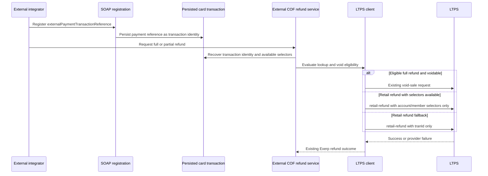

# DEV-77094 LTPS COF refund - Plan

## Goal Capsule

### Objective

External integrators can complete eligible full and partial refunds for LTPS card-on-file payments even when the account and card-holder member identifiers are unavailable.

### Means

Carry the registered external payment transaction reference into the LTPS external COF refund request and serialize exactly one supported LTPS selector form, while retaining the existing void path for eligible full refunds (KTD1, KTD2).

### Authority

Jira `DEV-77094` defines the product behavior. The Product Contract below preserves the brainstormed requirements and stable IDs. The repository defines the current data flow, existing refund routing, and test conventions. When these sources differ, product behavior follows the Product Contract and implementation mechanism follows the repository evidence.

### Stop conditions

Stop implementation if the LTPS request contract does not accept the stored external transaction reference as `tranId`, or if the available repository data cannot distinguish a usable account/member selector from the fallback case without amount-only matching. Do not broaden the change to unrelated clearing houses, new endpoints, or historical data repair.

### Execution profile

Implementation is code-focused and should proceed in dependency order from the request/data model through the LTPS client and service routing, followed by focused unit and behavior coverage. Preserve the existing error propagation path so a rejected or failed LTPS request cannot become a successful Exerp refund.

### Product Contract preservation

Product Contract unchanged; implementation planning has been added below.

## Product Contract

### Problem Frame

An external integrator can complete an online sale by registering an external LTPS COF payment, but the current refund request cannot use the LTPS transaction identity when the account and card-holder member identifiers are unavailable. This prevents the full or partial refund capability requested by `DEV-77094`.

### Summary

Use the registered `externalPaymentTransactionReference`, which is persisted as the credit-card transaction ID, as the LTPS `tranId` for the affected external COF refund flow. When member/account identifiers are insufficient, the LTPS refund request must use `tranId` alone; when the existing identifiers are available, the existing selector form remains valid and must not be mixed with `tranId`.

### Actors

- A1. External integrator — registers the external payment and initiates a later refund.
- A2. ShoppingBasket API and facade — validate and persist the external payment identity.
- A3. External COF refund service — recovers payment identity and chooses the selector form.
- A4. LTPS — processes the void or `retail-refund` request.

### Requirements

#### Registration and identity

- R1. The supported SOAP v5 external-payment registration contract must preserve `externalPaymentTransactionReference` as the LTPS transaction identity required for a later refund when account/member identifiers are unavailable.
- R2. The identity used for the LTPS payment must remain associated with the persisted credit-card transaction and be recoverable by the external COF refund flow.

#### Refund selection

- R3. When a usable LTPS transaction identity is available and the required account/member identifiers are unavailable, the `retail-refund` request must contain `tranId` and must omit `cardHolderMemberId` and `accountId`.
- R4. When the existing account/member identifiers are available, the existing identifier-based refund request must remain supported and must omit `tranId`.
- R5. The affected flow must cover both full and partial refunds, subject to the existing refund eligibility rules and the supported LTPS response contract. Eligible full refunds must retain the existing LTPS void behavior; partial and non-voidable full refunds use `retail-refund`.

#### Compatibility and outcome handling

- R6. Registrations and refunds outside the LTPS fallback case must retain their current behavior.
- R7. An LTPS rejection or transport failure must remain a failed refund outcome and must not be represented as a successful Exerp refund result.

### Key Decisions

- KD1. Use the persisted `externalPaymentTransactionReference` as the LTPS `tranId` in the fallback request because the repository already carries it as the credit-card transaction identity. Governs R1, R2, and R3.
- KD2. Keep eligible full-refund voids on the existing void endpoint and use `retail-refund` only when the existing routing requires a refund request. Governs R5 and R6.
- KD3. Treat the LTPS selectors as mutually exclusive request shapes because mixing `tranId` with account/member selectors is a fatal request-shape error. Governs R3, R4, and R7.

### Key Flows

- F1. External LTPS COF fallback refund
  - **Trigger:** An integrator requests a full or partial refund after registering an external payment.
  - **Actors:** A1, A2, A3, A4.
  - **Steps:** Registration preserves the external reference; the refund service recovers the persisted identity and available identifiers; the LTPS client selects exactly one selector form; the result follows existing success or failure conventions.
  - **Covered by:** R1-R7.

### Acceptance Examples

- AE1. **Fallback selector:** A fallback-case refund sends `tranId` and sends neither `cardHolderMemberId` nor `accountId`. Covers R3.
- AE2. **Full refund:** An eligible full refund of the fallback-case payment retains void behavior when LTPS permits voiding. Covers R5.
- AE3. **Partial refund:** A partial refund of the fallback-case payment uses `retail-refund` with the correct amount and transaction identity. Covers R3 and R5.
- AE4. **Existing selector:** A payment with usable account/member identifiers continues to use only the existing selector form. Covers R4 and R6.
- AE5. **Compatibility:** A non-fallback registration/refund path is unchanged. Covers R1, R2, and R6.
- AE6. **Failure:** An LTPS rejection or transport failure is not recorded as a successful refund. Covers R7.

### Scope Boundaries

In scope:

- The SOAP v5 external-registration data needed to preserve the LTPS transaction identity.
- Persistence and recovery of that identity for external COF refunds.
- LTPS selector choice for full and partial refunds in this case.
- Regression coverage for fallback, existing-selector, compatibility, and failure behavior.

Out of scope unless separately confirmed:

- Changes to unrelated clearing houses or the general refund model.
- New LTPS endpoints beyond the Jira-described `retail-refund` contract.
- Independent REST v6 implementation work; those surfaces are generated from the supported API definition and are not a separate implementation boundary for this change.
- Historical data migration or backfill.

### Assumptions

- The stored external payment reference is the provider-supported value for LTPS `tranId`, as stated by the source research plan and Jira context.
- Selector availability is determined from the refund request context before numeric conversion or request serialization; missing values must not be replaced with zero or inferred from the refund amount.
- The precise LTPS field-level validation for `tranId` is an execution-time compatibility check against the supported request contract, not a new product rule.

### Sources / Research

- Jira `DEV-77094` and blocking story `ST-17070` as recorded in the origin research plan.
- `api-soap-endpoint/src/main/java/dk/procard/eclub/api/v5/RegisterExternalPaymentParameters.java:19,60-65,119` exposes and validates the external payment reference.
- `api-soap-endpoint/src/main/java/dk/procard/eclub/api/v5/ShoppingBasketAPIBean.java:188-202` validates the SOAP registration input.
- `api-soap-impl/src/main/java/dk/procard/eclub/api/ShoppingBasketAPIImpl.java:114-129` maps the external reference into `PaymentInformation.paymentReference`.
- `common-base/src/main/java/com/exerp/clublead/server/gl/cr/PaymentInformation.java:15-40` carries the payment reference through the service boundary.
- `server-facade-impl/src/main/java/com/exerp/clublead/server/gl/cr/ShoppingBasketFacadeBean.java:808-826,1000-1028` creates the persisted credit-card transaction.
- `server-core-impl/src/main/java/com/exerp/clublead/server/paymentsession/payment/cardonfile/ExternalCardOnFilePaymentServiceBean.java:196-249,335-358` recovers the transaction identity and constructs the external refund request.
- `plugin-eft/src/main/java/dk/procard/eclub/gl/payment/eft/dataobjects/CardOnFileRefundRequestDO.java:7-54` is the shared external COF refund request object.
- `plugin-eft-impl/src/main/java/com/exerp/clublead/gl/payment/creditcard/ltps/LtpsAPIPaymentService.java:95-189` performs LTPS external COF refund routing and currently supplies the account/member selector to `retail-refund`.
- `plugin-eft-impl/src/main/java/com/exerp/clublead/gl/payment/creditcard/ltps/client/LtpsClient.java:24-29,62-68,116-135` defines the LTPS refund, lookup, and void endpoints.
- `plugin-eft-impl/src/main/java/com/exerp/clublead/gl/payment/creditcard/ltps/client/LtpsAuthRequest.java:40-53,76-108` models the current account/member request fields and is the request-model extension point.
- `plugin-eft-impl/src/test/java/com/exerp/clublead/gl/payment/creditcard/ltps/client/LtpsClientTest.java:188-210` verifies the current account/member refund payload.
- `plugin-eft-impl/src/test/java/com/exerp/clublead/gl/payment/creditcard/ltps/LtpsAPIPaymentServiceTest.java:175-281` verifies full, partial, void, and failure refund behavior.
- `server-core-impl/src/test/java/com/exerp/clublead/server/paymentsession/payment/cardonfile/ExternalCardOnFilePaymentServiceBeanTest.java` covers external COF payment-service behavior and is the closest server-side regression location.
- `test-behaviour/src/main/resources/com/exerp/clublead/cucumber/soap_api/v5/shopping_basket_api/registerExternalPayment.feature:3-40,91-113` covers SOAP registration and its required external reference.

## Planning Contract

### Key Technical Decisions

- KTD1. Model LTPS refund selector choice explicitly in the LTPS client/request layer, with separate construction paths for `tranId` and account/member identifiers. This keeps mutual exclusivity at the serialization boundary and prevents callers from accidentally emitting both forms. Supports KD1 and KD3.
- KTD2. Keep transaction lookup and void eligibility evaluation unchanged, and apply the new selector only on the `retail-refund` branch. This preserves current full-refund void behavior and limits the provider-contract change to the path that needs it. Supports KD2 and R5.
- KTD3. Carry the existing external transaction reference through the external COF request context rather than introducing a second identity lookup or amount-based fallback. If the current DTO needs an explicit field to distinguish the selector from the lookup reference, add it without changing other clearing-house callers. Supports R1, R2, and R6.
- KTD4. Fail closed when the fallback identity is absent or invalid for the provider contract. Do not serialize placeholder numeric values, and preserve `RefundNotAddedException` / existing response-handler failure behavior. Supports R3 and R7.

### High-Level Technical Design

The change has four directed stages: SOAP registration and persistence, external COF refund recovery, selector-aware LTPS request construction, and existing outcome capture. The current transaction lookup and void decision remain before selector construction.

The request-model sketch is directional: `retail-refund` must have one owner for selector construction, and the chosen branch must make the other selector fields absent from serialized JSON. Exact Java signatures and provider field types remain implementation details to confirm against the existing client conventions.

### Sequencing and dependencies

1. Confirm the persisted reference and external COF request context expose one unambiguous LTPS transaction identity.
2. Add selector-aware request construction and client entry points while preserving existing account/member payment behavior.
3. Update LTPS external COF refund routing to choose the fallback selector only when the required identifiers are unavailable.
4. Add focused client and service tests, then extend the registration/refund behavior coverage if the existing harness can exercise the full flow.
5. Run the repository-approved Java 8 verification gates listed below and check the final diff for selector exclusivity and unchanged non-fallback behavior.

### Risks and Dependencies

- **External contract risk:** The LTPS `tranId` field shape and validation must match the supported `retail-refund` contract. Mitigation: assert the serialized request body in client tests and confirm the contract before implementation is finalized.
- **Identity ambiguity risk:** Reusing a payment reference without proving it is the same LTPS identity could cause a refund to target the wrong transaction. Mitigation: preserve the existing transaction lookup and require a nonblank, provider-valid identity; never match by amount alone.
- **Compatibility risk:** The shared `CardOnFileRefundRequestDO` is used by multiple clearing-house handlers. Mitigation: preserve existing constructor semantics or add compatibility-preserving accessors, and exercise the LTPS-specific path without changing other handlers.
- **Failure-outcome risk:** A new client overload could accidentally bypass existing exception handling. Mitigation: route all provider failures through the existing `LtpsClientException` to `RefundNotAddedException` or response-handler path and assert rejection behavior.

### Deferred execution questions

- Confirm during implementation whether the current `originalExternalReference` is sufficient as the explicit LTPS `tranId` carrier or whether KTD3 requires a named DTO field. This does not block planning because both choices remain within the bounded shared-request boundary.
- Confirm the repository-approved test entry points for the affected modules before execution. The research source does not identify a permitted command, so no command is invented here.

## Implementation Units

### U1. Preserve and expose the external LTPS transaction identity

- **Goal:** Ensure the external COF refund request carries one unambiguous transaction identity from SOAP registration through persisted credit-card data into the LTPS handler.
- **Requirements:** R1, R2, R6.
- **Files:** `plugin-eft/src/main/java/dk/procard/eclub/gl/payment/eft/dataobjects/CardOnFileRefundRequestDO.java`; `server-core-impl/src/main/java/com/exerp/clublead/server/paymentsession/payment/cardonfile/ExternalCardOnFilePaymentServiceBean.java`; `server-core-impl/src/main/java/com/exerp/clublead/server/gl/PaymentAgreementServiceBean.java` only if the shared request construction requires compatibility updates.
- **Approach:** Trace the already-persisted `externalPaymentTransactionReference` to the external COF refund request. Prefer the existing original external reference when it is the same provider identity; otherwise add an explicit, compatibility-preserving accessor/field and update only the LTPS-producing caller. Do not alter unrelated clearing-house callers or introduce amount-based matching.
- **Patterns:** Follow `PaymentInformation.paymentReference`, `CreditCardPaymentInfo.getTransactionId()`, and the existing `CardOnFileRefundRequestDO` constructor/accessor style.
- **Test scenarios:**
  - Given a registered external reference, when the persisted credit-card transaction is recovered, then the refund request contains the same identity.
  - Given an existing non-LTPS or non-fallback caller, when it constructs the shared DTO, then its current fields and behavior remain unchanged.
  - Given a missing identity, when the LTPS fallback is selected, then the request fails closed before any amount-only lookup or provider call.
- **Verification:** Extend `server-core-impl/src/test/java/com/exerp/clublead/server/paymentsession/payment/cardonfile/ExternalCardOnFilePaymentServiceBeanTest.java` for request construction/recovery where its seams permit; otherwise cover the carrier at the LTPS service boundary in U2.

### U2. Add mutually exclusive LTPS refund request selectors

- **Goal:** Serialize `retail-refund` requests with either `tranId` alone or the existing account/member selectors, never both.
- **Requirements:** R3, R4, R6, R7.
- **Files:** `plugin-eft-impl/src/main/java/com/exerp/clublead/gl/payment/creditcard/ltps/client/LtpsAuthRequest.java`; `plugin-eft-impl/src/main/java/com/exerp/clublead/gl/payment/creditcard/ltps/client/LtpsClient.java`; `plugin-eft-impl/src/test/java/com/exerp/clublead/gl/payment/creditcard/ltps/client/LtpsClientTest.java`.
- **Approach:** Add the provider-supported `tranId` representation to the refund request model and create a selector-aware refund construction path. Make absent selector fields actually absent from serialized JSON rather than zero-valued. Preserve payment construction and the existing account/member refund entry point for callers that still have those identifiers.
- **Patterns:** Follow the current `LtpsAuthRequest` immutable request model, `LtpsClient.createRefund` validation, and `LtpsClientTest` HTTP body assertions.
- **Test scenarios:**
  - Given a negative refund amount and a transaction identity, when `createRefund` uses the fallback selector, then the request posts to `/payment-services-gateway-api/retail-refund`, contains `tranId`, and omits `cardHolderMemberId` and `accountId`.
  - Given a negative refund amount and account/member identifiers, when `createRefund` uses the existing selector, then the request contains both existing identifiers and omits `tranId`.
  - Given an invalid amount or absent selector, when the client is called, then it fails before sending an HTTP request.
  - Given a provider rejection or transport error, when the client posts the request, then the existing `LtpsClientException` conversion remains intact.
- **Verification:** Extend `LtpsClientTest` with request-body assertions for both selector forms and absence assertions for the mutually exclusive fields.

### U3. Route external COF refunds through the selected LTPS form

- **Goal:** Use the fallback `tranId` selector only when the external COF refund lacks the required account/member identifiers, while retaining existing void and identifier-based behavior.
- **Requirements:** R3, R4, R5, R6, R7.
- **Files:** `plugin-eft-impl/src/main/java/com/exerp/clublead/gl/payment/creditcard/ltps/LtpsAPIPaymentService.java`; `plugin-eft-impl/src/test/java/com/exerp/clublead/gl/payment/creditcard/ltps/LtpsAPIPaymentServiceTest.java`; `server-core-impl/src/main/java/com/exerp/clublead/server/paymentsession/payment/cardonfile/ExternalCardOnFilePaymentServiceBean.java` only if U1 changes the request carrier.
- **Approach:** Keep the original transaction lookup and full-refund void branch unchanged. In the `retail-refund` branch, select the fallback client path when the request context lacks usable account/member identifiers, passing the recovered external transaction identity as `tranId`; otherwise call the existing identifier-based path. Preserve the current exception-to-failed-refund mapping.
- **Patterns:** Follow `executeCardOnFileRefund`, `LtpsTransaction.mayVoid()`, `RefundNotAddedException`, and the existing Mockito interaction assertions.
- **Test scenarios:**
  - Given a fallback-case eligible full refund and a voidable LTPS transaction, when the refund is sent, then LTPS receives the existing void request and no retail refund is created.
  - Given a fallback-case partial refund, when the refund is sent, then LTPS receives `retail-refund` with `tranId` only and the requested negative amount.
  - Given a fallback-case full refund that is not voidable, when the refund is sent, then LTPS receives `retail-refund` with `tranId` only.
  - Given available account/member identifiers, when a partial or non-voidable full refund is sent, then the existing identifier-based request is used and `tranId` is absent.
  - Given an LTPS rejection, transport failure, already-voided transaction, or missing identity, when the refund is sent, then the operation raises or returns the existing failed-refund outcome and never records success.
- **Verification:** Extend `LtpsAPIPaymentServiceTest` with fallback full/partial/non-voidable cases, selector interaction assertions, and failure cases; keep existing void and identifier-based tests green.

### U4. Extend end-to-end registration/refund regression coverage

- **Goal:** Prove that the supported external registration contract continues to preserve the identity needed by the refund path and that non-fallback behavior remains compatible.
- **Requirements:** R1, R2, R5, R6.
- **Files:** `test-behaviour/src/main/resources/com/exerp/clublead/cucumber/soap_api/v5/shopping_basket_api/registerExternalPayment.feature`; `server-core-impl/src/test/java/com/exerp/clublead/server/paymentsession/payment/cardonfile/ExternalCardOnFilePaymentServiceBeanTest.java` if an existing scenario seam can observe the carried identity.
- **Approach:** Extend existing registration coverage with the identity-preservation assertion that is supported by the current behavior harness. Add a focused refund scenario only if the harness already provides the required invoice, card-on-file, and LTPS seams; otherwise leave provider-payload proof to U2/U3 and record the limitation in verification output.
- **Patterns:** Follow the existing SOAP v5 feature's Given/When/Then structure and its required `externalPaymentTransactionReference` cases.
- **Test scenarios:**
  - Given a valid SOAP v5 external payment registration with `externalPaymentTransactionReference`, when the registration completes, then the identity remains available to the external COF refund path.
  - Given the existing missing-reference validation case, when registration is attempted, then the current validation failure remains unchanged.
  - Given a non-fallback registration/refund flow, when its existing selectors are available, then no `tranId` fallback behavior is introduced.
- **Verification:** Run the focused SOAP registration behavior coverage if the existing harness can execute it, and retain the current missing-reference regression.

## Verification Contract

| Gate | Applies to | Evidence required |
| --- | --- | --- |
| LTPS client request-shape tests | U2 | JSON body proves exactly one selector form and preserves amount/endpoint validation. |
| LTPS service routing tests | U3 | Full, partial, voidable, non-voidable, existing-selector, missing-identity, provider-rejection, and transport-failure scenarios pass. |
| External COF carrier tests | U1 | Persisted external reference is recoverable without amount-only matching; unrelated DTO callers remain compatible. |
| SOAP registration behavior coverage | U4 | Existing valid and missing-reference scenarios pass; identity-preservation coverage is added where the harness supports it. |
| Repository quality gates | U1-U4 | Use the repository-approved Java 8 test and static-analysis entry points for the affected modules. The exact permitted command is an execution-time prerequisite and is not specified here because the source research did not identify it. |

No implementation test command is run during planning.

## Definition of Done

- R1-R7 are implemented without changing the Product Contract's scope or selector exclusivity.
- The persisted external transaction identity reaches the LTPS fallback request and is not replaced by amount-only matching.
- `retail-refund` emits either `tranId` alone or the existing account/member selectors, never both.
- Eligible full refunds retain the existing void behavior.
- Partial and non-voidable full refunds use the correct selector-aware `retail-refund` path.
- LTPS rejection, transport failure, invalid identity, and already-voided outcomes remain failed refunds under existing conventions.
- Focused client, service, carrier, and applicable behavior tests cover happy paths, edge cases, and failures listed in U1-U4.
- Non-LTPS and non-fallback clearing-house behavior is unchanged.
- No abandoned experimental code, placeholder selector values, amount-only matching, or unrelated refactors remain in the final change.

## Appendix

### Origin readiness and planning disposition

The origin research plan recorded one remaining validation question: what validation is required for the transaction identity beyond accurately identifying the payment and avoiding amount-only matching. This plan treats provider-format validation as an implementation-time compatibility check and makes absence/invalidity fail closed. If the LTPS contract contradicts the Jira-described `tranId` behavior, implementation must stop under the Goal Capsule stop conditions rather than invent a new product rule.

### Origin engineering decision log

The origin's hardest decision was separating the persisted payment identity from the selector sent to LTPS. The rejected alternatives were relying only on account/member selectors and replacing eligible full-refund voids with `retail-refund`. The fatal flaw identified by the origin was serializing `tranId` together with account/member selectors. Those decisions are preserved in KD1-KD3 and KTD1-KTD2.
