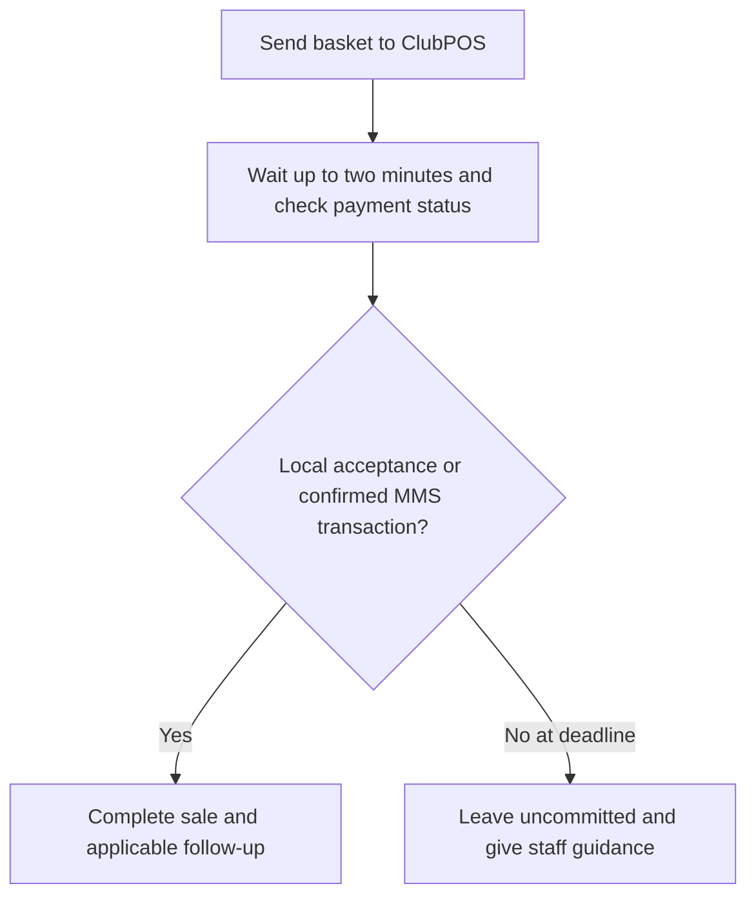
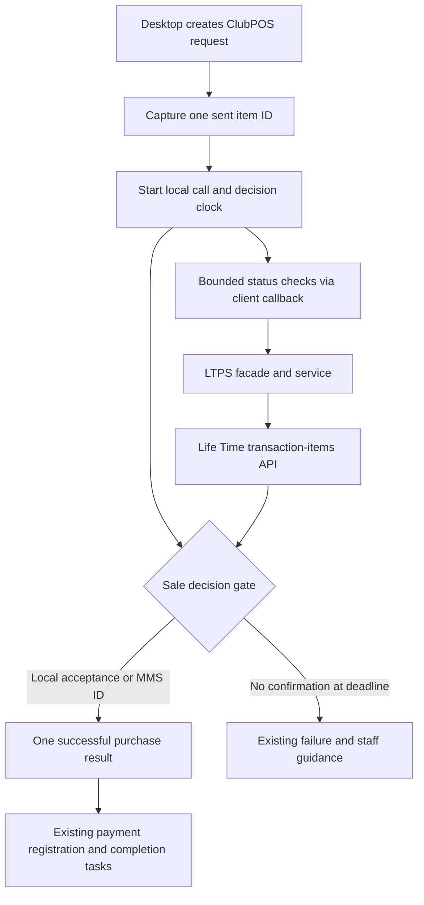
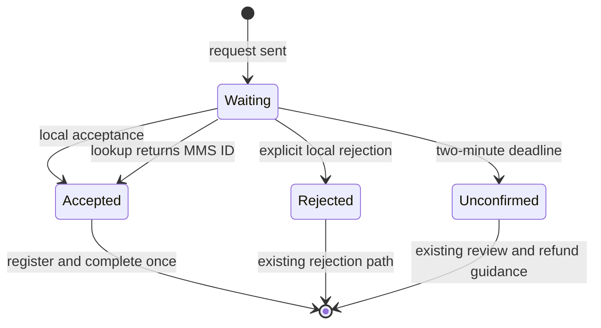

# DEV-77601 ClubPOS basket item confirmation - Plan

## Goal Capsule

- **Objective:** Complete a Life Time ClubPOS sale when payment was collected but the local acceptance response did not reach Exerp.
- **Product authority:** [DEV-77601](https://clublead.atlassian.net/browse/DEV-77601), its October 6 comment, and the user's decisions on the lookup ID, two-minute deadline, and unconfirmed outcome.
- **Open blockers:** None identified for requirements planning. The conditions under which a basket item ID is available need verification during implementation planning.

---

## Product Contract

### Summary

While the Exerp client waits for a Life Time ClubPOS payment response, it checks the new payment confirmation API using an item external ID sent in that ClubPOS request. A confirmed payment completes the sale. If payment remains unconfirmed at the two-minute deadline, the sale remains uncommitted and staff receive the existing review and refund guidance.

### Problem Frame

ClubPOS can collect payment even when its local acceptance response is lost. Exerp then reports a failed sale while ClubPOS retains the payment. The invoice-style line ID shown in the API example is created after a successful commit, so it cannot identify the payment during this failure. The sent basket item external ID exists earlier. The current local ClubPOS HTTP call does not enforce the two-minute wait described in DEV-77601.

### Actors

- A1. **Front desk staff member:** Starts the ClubPOS sale and receives guidance when collection cannot be confirmed.
- A2. **Exerp desktop client:** Sends the basket, checks payment status, and determines the sale outcome.
- A3. **ClubPOS and Life Time payment service:** ClubPOS collects the basket payment; the payment service reports whether a sent item belongs to a collected transaction.

### Key Decisions

- **Use the sent basket item ID.** Governs R2 and R3. The confirmation lookup uses the `<basketId>I<itemKey>` value sent to ClubPOS, such as `15348230I2` (session-settled: user-directed — chosen over the post-commit invoice-style ID because that ID is unavailable when the local response is lost).
- **Apply a two-minute deadline.** Governs R4 and R6. DEV-77601 describes this wait, and the user selected it despite the current local HTTP call having no enforced timeout (session-settled: user-directed — chosen over an unbounded wait so a nonresponding ClubPOS request reaches a decision).
- **Require positive collection evidence.** Governs R5 and R6. An `mmsTranId` confirms collection; an inconclusive lookup does not (session-settled: user-directed — chosen over leaving the sale pending in Exerp because staff should receive the existing review and refund guidance at the deadline).

### Requirements

**Payment identification**

- R1. Limit recovery to Life Time sales using the local ClubPOS credit card terminal flow when the local acceptance response is missing.
- R2. Supply the new confirmation API's `externalItemId` with only an `EXTERNAL_ITEM_ID` actually sent in the current ClubPOS request; do not substitute the post-commit invoice-style ID.
- R3. Treat the ClubPOS request as one basket payment even when it contains several eligible items or spans several invoices; any sent item ID used for lookup must refer to that payment.

**Sale outcome**

- R4. Check payment status while the local response is pending, with a two-minute deadline for the sale decision.
- R5. If the confirmation API returns an `mmsTranId` for the sent item before the decision deadline, treat the payment as collected and complete the sale instead of reporting “Failed to Commit.”
- R6. If neither the local response nor the confirmation API establishes collection by the deadline, leave the sale uncommitted and give staff the existing transaction review and refund guidance.
- R7. A recovered sale must receive the applicable post-payment handling of a normally accepted ClubPOS sale, including the clipcard ID exchange described in the October 6 Jira comment when relevant.

### Key Flows

- F1. **Local response arrives.** Exerp handles the ClubPOS response through the existing sale outcome. Covers R1.
- F2. **Local acceptance is lost; payment is confirmed.** Exerp looks up a sent basket item ID during the wait, receives an `mmsTranId`, and completes the sale with applicable follow-up. Covers R2–R5 and R7.
- F3. **Collection remains unconfirmed.** The local acceptance is absent and the lookup has not confirmed collection at two minutes; Exerp leaves the sale uncommitted and gives staff the existing guidance. Covers R4 and R6.

### Acceptance Examples

- AE1. **Covers R2, R4, R5, R7.** **Given** ClubPOS collected payment but its local response was lost, **when** the confirmation API returns an `mmsTranId` for the sent ID `15348230I2` within two minutes, **then** Exerp completes the sale and applicable post-payment handling.
- AE2. **Covers R2, R3, R5.** **Given** a ClubPOS request contains items from more than one invoice, **when** a sent item ID identifies the collected basket payment, **then** Exerp recovers the sale without querying a post-commit invoice-style ID.
- AE3. **Covers R4, R6.** **Given** no local acceptance arrives, **when** the lookup returns 404, fails, or remains inconclusive through the two-minute deadline, **then** Exerp leaves the sale uncommitted and gives staff the existing review and refund guidance.
- AE4. **Covers R1.** **Given** a payment uses another payment path, **when** it is processed, **then** this ClubPOS recovery rule does not change its outcome.

### Scope Boundaries

- The scope is the Life Time desktop client's local ClubPOS terminal sale flow. DEV-77601 identifies Datacap and server-side Card on File as separate paths.
- Automated reversal or refund and sale failures unrelated to a missing ClubPOS acceptance response are outside this recovery behavior.
- The local ClubPOS simulator described in DEV-77601 can reproduce a collected payment with a lost response, but it does not simulate the new confirmation API.

### Dependencies and Assumptions

- Life Time must provide the confirmation API and authorize Exerp's request. DEV-77601 says the Exerp Point of Sale client credentials may be used; credential values are outside this plan.
- A sent basket item must have a nonempty external ID for the lookup in R2. Current ID generation depends on terminal, basket-key, and center-setting conditions; planning must verify those conditions for Life Time.
- DEV-77601 says any item ID sent in one basket request should resolve to the same MMS transaction. R3 depends on that cross-system behavior.

### Outstanding Questions

- **Deferred to Planning:** How should the client coordinate a late local response and a confirmation result so the sale completes only once?
- **Deferred to Planning:** What lookup schedule within the two-minute window provides a useful answer while meeting R4–R6?
- **Deferred to Planning:** Which Life Time configuration guarantees that an eligible sent item has the external ID required by R2?

### Sources and Research

- [DEV-77601](https://clublead.atlassian.net/browse/DEV-77601): reported mismatch, user story, Product Team notes on the sent `<basketId>I<itemKey>` ID, and the October 6 comment on `mmsTranId`, 404, and clipcard handling. The linked [ST-17128](https://clublead.atlassian.net/browse/ST-17128) repeats the core recovery agreement. No Confluence page was linked.
- `plugin-hardware-impl/src/main/java/dk/procard/eclub/devices/drivers/clubpos/ClubPOSDevice.java:179`: builds one request and sets each included product's external item ID from its sales line. Its purchase path does not read the returned transaction ID.
- `plugin-hardware-impl/src/main/java/dk/procard/eclub/devices/drivers/clubpos/DefaultClubPOSWebHandler.java:38`: executes the local HTTP call without an explicit timeout. `plugin-hardware-impl/src/main/java/dk/procard/eclub/devices/drivers/clubpos/ClubPOSDriver.java:20` exposes a timeout property with a 180-second default.
- `client/src/main/java/com/exerp/clublead/client/gl/payment/SalesLineCreator.java:44` and `client/src/main/java/com/exerp/clublead/client/gl/cr/PaymentSessionClient.java:1037`: carry a payment-session external line ID into each sales line.
- `server-shared/src/main/java/com/exerp/clublead/server/paymentsession/payment/InvoiceLineItemExternalId.java:50`: generates the pre-commit `<basketId>I<itemKey>` value despite the Java type's invoice-oriented name. `server-shared/src/main/java/dk/procard/eclub/gl/gl/ShoppingBasketInvoiceFactory.java:402` shows the generation conditions.
- `plugin-eft-impl/src/main/java/com/exerp/clublead/gl/payment/creditcard/ltps/client/LtpsClient.java:123`: its existing transaction lookup takes a numeric transaction ID, a different identity from R2. `plugin-eft-impl/src/main/java/com/exerp/clublead/gl/payment/creditcard/ltps/client/LtpsBearerTokenClient.java:24` documents bearer-token handling.

### 🧠 Engineering Decision Log

1. **What was the hardest decision you made here?** The ticket expects a two-minute decision, but the current local HTTP call has no enforced timeout and the driver exposes a 180-second property. The user chose two minutes, so R4 and R6 state that product deadline while leaving the lookup schedule and late-response coordination to planning.
2. **What alternatives were rejected?** The invoice-style ID in the API example was ruled out because DEV-77601 and the user say it exists only after commit; R2 uses the ID sent before commit. Checking only after the local request ends was ruled out because the current call can remain pending, while DEV-77601 requires lookup during the wait.
3. **What is the fatal flaw?** R2 depends on an eligible product carrying a nonempty basket item external ID that Life Time's API can match before the deadline. Code shows ID generation is conditional; if that value is absent or the confirmation service cannot find it in time, Exerp cannot safely recover a collected payment under R5.

---

## Planning Contract

**Product Contract preservation:** Product Contract unchanged.

### Key Technical Decisions

- KTD1. **Use the serialized ClubPOS request as the lookup source.** Select one nonblank `externalItemId` from a product actually included in the current request, after installment lines have been excluded. This implements R2–R3 without reconstructing an ID from an invoice or a separate basket view.
- KTD2. **Keep Life Time authentication on the server.** Extend the existing LTPS client, service, and facade path for the transaction-items lookup. The client supplies its current payment-session identity and the sent item ID; the server checks the caller's scoped cashier permission for that session's center, verifies the item belongs to the session, and resolves credentials from the configured LTPS clearing house. This avoids distributing OAuth secrets to the desktop and limits arbitrary transaction lookup.
- KTD3. **Use one per-sale decision gate.** Start a monotonic 120-second clock when the local request is sent. Observe the local call and bounded status lookups concurrently; the first valid local acceptance or positive lookup before the deadline produces one successful purchase result. An explicit local rejection retains the existing rejection path. At the deadline, if neither path has confirmed collection, return the existing failure outcome. Late results cannot register another payment. This implements R4–R6.
- KTD4. **Poll within the deadline.** Begin the first lookup after a short five-second grace period, then retry at ten-second intervals while the local response is pending or after its transport fails. Stop checks on local acceptance, explicit rejection, positive lookup, or the deadline. Treat 404, malformed or empty responses, authentication failures, and lookup transport errors as inconclusive, with bounded per-attempt time and diagnostic logging. This schedule is an implementation choice for R4–R6; it can be tuned only if Life Time's service limits or measured latency require it.
- KTD5. **Reuse the normal commit path.** Map a confirmed lookup to the same successful `CreditCardPurchaseResult` route used by local ClubPOS acceptance, carrying the returned transaction ID where the purchase result supports it. `PaymentAmountController` should register the payment once and run its normal completion tasks. This implements R5 and R7 without a second sale-commit entry point.

### High-Level Technical Design

The desktop device owns the request and the sale decision; its confirmation callback crosses to the existing LTPS facade. The facade verifies the active session and delegates to the server service, which uses the configured LTPS client and OAuth token. The result returns to the device as either positive collection evidence or an inconclusive lookup.

### Dependencies and Risks

- The Life Time API and OAuth configuration must be available in the relevant environment. The ticket documents the endpoint and `mmsTranId` response, but does not publish a latency or rate-limit contract; verify those properties during integration testing before changing KTD4's schedule.
- `ShoppingBasketInvoiceFactory` generates the pre-commit ID only when the basket key exists, the terminal condition matches, and `GENERATE_INVOICE_LINE_EXTERNAL_ID` is enabled for the center. Confirm Life Time's deployed setting and inspect a real serialized ClubPOS request before rollout. A sale with no sent ID can still use a timely local response, but cannot be recovered from the status API.
- The current local HTTP handler has no enforced timeout, and the shared LTPS HTTP helper reads the response body before classifying a non-success status. The LTPS bearer-token client also performs network acquisition while holding a shared lock. The implementation must bound local I/O, the complete status lookup including token acquisition and lock wait, and safely handle a 404 with no body; otherwise the two-minute decision and R6 cannot be guaranteed.
- The October 6 Jira comment requires the clipcard ID exchange when applicable. The current ClubPOS purchase path does not itself send a clipcard ID; trace the normal after-sale and MMS export behavior during U4. If a separate immediate API operation is required, its contract is unavailable and must be obtained before claiming R7 complete.
- A timeout or client restart after Life Time has collected payment can still leave an unconfirmed sale. The existing staff review and refund process remains the fallback under R6; automated reversal is outside scope.

### Sequencing

Before U1, use a representative ClubPOS basket in the target environment to confirm that the deployed center emits a nonblank product `externalItemId` and that the documented endpoint accepts that exact ID; record the setting and response as integration evidence. Build the server lookup contract first (U1), then the bounded desktop callback and sale decision (U2–U3). Map recovery through normal payment registration and verify downstream handling last (U4). Keep the status request read-only; no lookup may create or reverse a payment.

---

## Implementation Units

### U1. Add a scoped Life Time transaction-item lookup

- **Goal:** Return positive collection evidence for a sent item without exposing credentials to the desktop.
- **Requirements:** R2, R3, R5, R6; F2–F3; KTD2, KTD4.
- **Dependencies:** None.
- **Files:** `plugin-eft-impl/src/main/java/com/exerp/clublead/gl/payment/creditcard/ltps/client/LtpsClient.java`; `plugin-eft-impl/src/main/java/com/exerp/clublead/gl/payment/creditcard/ltps/client/LtpsBearerTokenClient.java` if the existing token path needs bounded acquisition; `plugin-eft-impl/src/main/java/com/exerp/clublead/gl/payment/AbstractRestAPIClient.java` if empty-body handling is needed; a response type beside `LtpsClient`; `server-core/src/main/java/com/exerp/clublead/server/ltps/LtpsService.java`; `server-core-impl/src/main/java/com/exerp/clublead/server/ltps/LtpsServiceBean.java`; `server-facade/src/main/java/com/exerp/clublead/server/ltps/LtpsFacade.java`; `server-facade-impl/src/main/java/com/exerp/clublead/server/ltps/LtpsFacadeBean.java`; `plugin-eft-impl/src/test/java/com/exerp/clublead/gl/payment/creditcard/ltps/client/LtpsClientTest.java`; `plugin-eft-impl/src/test/java/com/exerp/clublead/gl/payment/creditcard/ltps/client/LtpsBearerTokenClientTest.java`; `server-core-impl/src/test/java/com/exerp/clublead/server/ltps/LtpsServiceBeanTest.java`; `server-facade-impl/src/test/java/com/exerp/clublead/server/ltps/LtpsFacadeBeanTest.java`.
- **Approach:** Use the ticket's transaction-items endpoint with `transactionSource=Exerp` and the supplied item ID. Load the active payment session, check the caller's scoped cashier permission for its center, and validate that the ID belongs to it before the remote call. Return a positive result only for a usable `mmsTranId`; distinguish 404 from a service fault for logs while exposing both as inconclusive to the sale decision. Bound the entire lookup, including OAuth token acquisition and any shared-lock wait, without imposing a new timeout on unrelated LTPS operations.
- **Patterns to follow:** `LtpsServiceBean` already resolves LTPS clearing-house credentials by scope; `LtpsClient` already adds bearer authorization and URL query parameters; `PaymentService.getExternalLineIds` exposes the session's candidate IDs; `ShoppingBasketFacadeBean` checks scoped cashier access.
- **Test scenarios:**
  - Covers AE1. Given a session-owned sent item ID and a 200 response with a nonzero `mmsTranId`, when the facade performs the lookup, then it returns that ID using the configured OAuth path.
  - Covers AE2. Given either of two sent IDs in one basket, when each resolves to the same MMS transaction, then the lookup accepts either without converting it to an invoice ID.
  - Covers AE3. Given a 404 with an empty body, when the lookup runs, then it returns inconclusive evidence without an uncaught parse or null error.
  - Given 200 with a missing, null, or invalid `mmsTranId`, when parsed, then no collection is confirmed.
  - Given an ID outside the active session or center, when the facade is called, then the remote lookup is refused.
  - Given a caller without cashier access to the session's center, when the facade is called with a matching session and item ID, then the remote lookup is refused.
  - Given token, authorization, or transport failure, when the lookup runs, then the error is diagnosable and cannot be mistaken for collection.
  - Given token acquisition or a shared token-lock wait that stalls, when the lookup's time budget expires, then it cannot hold the sale decision past its deadline or retain unbounded lookup work.
- **Verification:** Contract tests prove the exact endpoint, encoded query values, bearer authorization, response interpretation, empty-body 404 behavior, scoped caller access, session binding, and a bound covering token acquisition.

### U2. Pass ClubPOS confirmation through the desktop callback

- **Goal:** Let the ClubPOS device request server-side status for an ID in its own serialized request.
- **Requirements:** R1–R3; F2; KTD1–KTD2.
- **Dependencies:** U1.
- **Files:** `plugin-hardware/src/main/java/com/exerp/clublead/hardware/device/creditcardterm/ServerPurchaseCallback.java` or a narrow ClubPOS-specific callback beside it; `client/src/main/java/com/exerp/clublead/client/gl/payment/CreditCardServerPurchaseCallback.java`; `client/src/main/java/com/exerp/clublead/client/gl/payment/PaymentAmountController.java`; `plugin-hardware-impl/src/main/java/dk/procard/eclub/devices/drivers/clubpos/ClubPOSDevice.java`; `client/src/test/java/com/exerp/clublead/client/gl/payment/CreditCardServerPurchaseCallbackTest.java`; `plugin-hardware-impl/src/test/java/dk/procard/eclub/devices/drivers/clubpos/ClubPOSDeviceTest.java`.
- **Approach:** Bind the callback to the current payment session at purchase start. After `createRequest` filters installment lines, select a nonblank external ID from its products and pass that exact value through the callback. Keep other terminal implementations and payment paths on their current callback behavior. If no ID was sent, skip status checks and retain the local response and deadline handling.
- **Patterns to follow:** `CreditCardServerPurchaseCallback` already bridges terminal work to server facades; `ClubPOSDevice.createRequest` is the authoritative product filter; `SalesLineCreator` carries the payment-session ID into each sales line.
- **Test scenarios:**
  - Covers AE1. Given a request with a sent ID, when status is checked, then the callback passes that ID and the current session identity to the LTPS facade.
  - Covers AE2. Given multiple products from multiple invoices, when one eligible sent ID is chosen, then no omitted installment ID or post-commit ID is queried.
  - Given every sent product has a blank ID, when the device waits, then no status call is made and no fabricated ID is used.
  - Covers AE4. Given another terminal path, when its purchase callback runs, then it never invokes ClubPOS confirmation.
- **Verification:** Device and callback tests identify the exact ID sent on the wire and establish that only the local ClubPOS sale path uses recovery.

### U3. Bound and arbitrate the local response and status checks

- **Goal:** Make one sale decision within two minutes while the local response and status lookup may finish in either order.
- **Requirements:** R4–R6; F1–F3; KTD3–KTD4.
- **Dependencies:** U1–U2.
- **Files:** `plugin-hardware-impl/src/main/java/dk/procard/eclub/devices/drivers/clubpos/ClubPOSDevice.java`; `plugin-hardware-impl/src/main/java/dk/procard/eclub/devices/drivers/clubpos/DefaultClubPOSWebHandler.java`; a testable sale-decision coordinator beside those classes if needed; `plugin-hardware-impl/src/test/java/dk/procard/eclub/devices/drivers/clubpos/ClubPOSDeviceTest.java`; `plugin-hardware-impl/src/test/java/dk/procard/eclub/devices/drivers/clubpos/ClubPOSPaymentCoordinatorTest.java` if a coordinator is extracted.
- **Approach:** Observe local I/O and status checks concurrently behind one monotonic deadline. Bound each network attempt by the remaining time, stop scheduling at the deadline, close or cancel outstanding local HTTP work, and ignore late completion for sale registration. Preserve an explicit local ClubPOS rejection as the existing failure path; a transport loss remains eligible for status recovery until the deadline. Return exactly one terminal result or failure to `CreditCardPayAction`.
- **Execution note:** Characterize current local success, error, and transport-failure behavior before changing their timing.
- **Test scenarios:**
  - Covers AE1. Given a hanging local request and a positive lookup at 30 seconds, when the lookup completes, then the purchase succeeds once before the deadline.
  - Covers AE3. Given repeated 404 responses through 120 seconds, when the deadline arrives, then the purchase fails once with the existing review and refund route.
  - Given a local acceptance before the first lookup, when the local call completes, then its normal success path wins without waiting for a lookup.
  - Given a local transport failure followed by a positive lookup, when confirmation arrives before the deadline, then the sale succeeds.
  - Given an explicit local error response, when it arrives before collection confirmation, then the existing rejection path runs.
  - Given local acceptance and lookup confirmation nearly together, when both complete, then only one purchase result is returned and the payment is registered once.
  - Given confirmation at or after the deadline, when the result arrives, then it cannot change an already unconfirmed outcome.
  - Given a lookup or local call that stalls, when 120 seconds elapse, then the decision completes without retaining an unbounded active request.
- **Verification:** Deterministic clock and controlled-future tests establish ordering, deadline, cancellation, and single-result behavior without waiting two real minutes.

### U4. Complete recovered sales through normal post-payment handling

- **Goal:** Register a recovered payment and execute the same applicable completion work as a locally accepted ClubPOS payment.
- **Requirements:** R5, R7; F1–F2; KTD5.
- **Dependencies:** U3.
- **Files:** `plugin-hardware-impl/src/main/java/dk/procard/eclub/devices/drivers/clubpos/ClubPOSDevice.java`; `client/src/main/java/com/exerp/clublead/client/gl/payment/PaymentAmountController.java` only if result mapping requires it; `client/src/main/java/com/exerp/clublead/client/gl/cr/PaymentSessionClient.java` only if the existing registration path cannot carry the recovered reference; `plugin-hardware-impl/src/test/java/dk/procard/eclub/devices/drivers/clubpos/ClubPOSDeviceTest.java`; `client/src/test/java/com/exerp/clublead/client/gl/payment/PaymentAmountControllerTest.java` if client behavior changes.
- **Approach:** Carry the positive lookup's MMS transaction ID into the purchase result and allow the existing `PaymentAmountController` to call `registerClientCreditCardPayment` once. Trace `PaymentSessionClient.afterSale`, payment completion tasks, and Life Time's clipcard export against a normally accepted sale; add only the missing integration needed for R7 if that trace shows a gap and the external contract is available.
- **Test scenarios:**
  - Covers AE1. Given a lost local acceptance and positive lookup, when payment registration succeeds, then the basket commits once and normal completion tasks run once.
  - Given a locally accepted ClubPOS payment, when the same sale completes, then its outcome and completion tasks remain unchanged.
  - Given a recovered clipcard sale, when the sale commits, then the same clipcard identifier handling observable for a normal ClubPOS clipcard sale occurs.
  - Given server registration fails after positive collection evidence, when the client reports the failure, then it does not claim an unconfirmed collection and does not start a second terminal charge.
- **Verification:** A focused client integration test and a Life Time QA scenario show one committed sale, the recorded MMS reference, and matching normal versus recovered clipcard follow-up.

---

## Verification Contract

| Evidence | Pass condition |
|---|---|
| LTPS client and server contract tests | The request uses the sent item ID, authorized endpoint, and a bound covering token acquisition; a scoped cashier can query the active session, while another caller cannot. A valid MMS ID confirms collection; 404 and malformed responses do not. |
| ClubPOS device and callback tests | An eligible product in the serialized request supplies the lookup ID; absent IDs cause no guessed lookup; other terminal paths do not change. |
| Deterministic sale-decision tests | Local acceptance, lookup confirmation, explicit rejection, transport loss, deadline, and nearly simultaneous results each yield one defined outcome. |
| Client sale integration test | Recovered collection registers and commits once, with the same completion tasks as local acceptance. |
| Life Time QA smoke check | Use the local simulator's lost-response and hang modes with a controlled transaction-items response source; inspect one completed sale for positive confirmation and the existing staff guidance for inconclusive status. Verify the serialized ID and applicable clipcard follow-up. |

---

## Definition of Done

- U1: The server lookup is authenticated, session-bound, and returns positive evidence only for a valid MMS transaction ID.
- U2: The lookup uses only an ID in the current ClubPOS request; other terminal paths are unchanged.
- U3: Every sale decision completes within the two-minute window, with no late second result and no unbounded request left running.
- U4: A recovered sale commits once and receives all applicable normal post-payment handling, including verified clipcard behavior.
- The acceptance examples AE1–AE4 pass in automated or controlled QA evidence; the Life Time environment setting and endpoint access are verified before rollout.
- Any abandoned experimental code is removed from the final change, and no credential value is added to source or logs.
