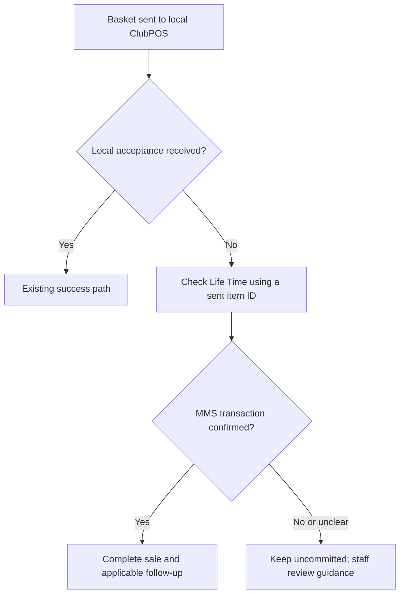

# DEV-77601 ClubPOS payment status recovery - Plan

## Goal Capsule

- **Objective:** Complete a ClubPOS sale when Life Time confirms that payment was collected even though the local ClubPOS acceptance response did not reach Exerp.
- **Product authority:** [DEV-77601](https://clublead.atlassian.net/browse/DEV-77601) supplies the reported failure, expected recovery, and Product Team notes. Its October 6 comment clarifies the response handling. The user confirmed the scope and the unconfirmed-payment behavior in this session.
- **Open blocker:** Product must confirm the decision deadline and lookup timing before implementation planning. The ticket describes a two-minute timeout, but the current local HTTP call does not enforce one.

## Product Contract

### Summary

For Life Time ClubPOS sales, check the status of the payment associated with the basket sent to ClubPOS when its local acceptance response is missing. Complete the sale when the payment service confirms collection. Keep an unconfirmed sale uncommitted and give staff the existing review and refund guidance.

### Problem Frame

Life Time reports that ClubPOS can collect a customer's payment while its acceptance response is lost between the front desk application and Exerp. Exerp then treats the sale as failed, leaving a paid transaction without a committed sale. DEV-77601 describes a two-minute wait, while the current local HTTP handler has no enforced request timeout. The ticket's invoice-style example ID also differs from the basket line ID available when the sale has not yet committed.

### Actors

- A1. **Front desk staff member:** Starts the sale and may need to review an unresolved payment.
- A2. **Exerp desktop client:** Sends the basket to local ClubPOS and decides whether to complete the sale.
- A3. **ClubPOS and Life Time payment service:** ClubPOS collects the payment; the payment service reports whether a sent basket item has a matching MMS transaction.

### Key Decisions

- **Use the sent item identity.** Governs R2 and R3. The Product Team notes say the pre-commit basket line ID is the identifier Life Time receives; the invoice-style example is unavailable at the failure point.
- **Require positive collection evidence.** Governs R4 and R5. The user confirmed that an unavailable or unclear lookup leaves the sale uncommitted with existing staff guidance. A returned `mmsTranId` is the positive evidence described in DEV-77601.
- **Leave the deadline to Product.** Governs R6. The user chose to keep timing open because the ticket's two-minute account conflicts with the current local call.

### Requirements

**Payment identification**

- R1. Limit this recovery behavior to Life Time sales paid through the local ClubPOS credit card terminal flow.
- R2. Query the Life Time payment service for an `EXTERNAL_ITEM_ID` actually sent in the current ClubPOS basket request, rather than an invoice ID created after commit.
- R3. Treat the ClubPOS request as one basket payment even when it contains several lines or spans more than one invoice; a sent line ID must identify the payment being recovered.

**Sale outcome**

- R4. When the local acceptance response is missing and the payment service returns an `mmsTranId` for the sent item, treat the payment as collected and complete the sale instead of marking it “Failed to Commit.”
- R5. If no positive collection confirmation is available when a decision must be made and the local response is still missing, keep the sale uncommitted and show the current transaction review and refund guidance. A 404, service failure, or unclear response is not proof of payment.
- R6. Check payment status while the local response is pending; Product must confirm the decision deadline and lookup timing before planning.
- R7. A recovered sale must proceed through the same applicable post-payment completion behavior as a sale confirmed by the local ClubPOS response, including the clipcard ID exchange described in the October 6 Jira comment when the sale involves a clipcard.

### Key Flows

- F1. **Local response arrives.** Staff starts a ClubPOS sale; ClubPOS returns its normal acceptance or error response; Exerp follows the existing outcome for that response. Covers R1.
- F2. **Local acceptance is lost, payment found.** Exerp checks a sent basket item while waiting; Life Time confirms collection; Exerp completes the sale and applicable follow-up. Covers R2–R4, R6, R7.
- F3. **Payment remains unconfirmed.** Exerp receives no local acceptance and no positive lookup confirmation; it leaves the sale uncommitted and directs staff to review the payment. Covers R5 and R6.

### Acceptance Examples

- AE1. **Covers R2–R4, R7.** **Given** ClubPOS collected a basket payment and its local success response was lost, **when** the payment service returns an `mmsTranId` for an item ID sent in that basket, **then** Exerp completes the sale and applicable post-payment handling.
- AE2. **Covers R2, R3, R4.** **Given** one ClubPOS request contains lines associated with more than one invoice, **when** a sent line ID identifies a collected payment, **then** Exerp recovers that basket sale without relying on a post-commit invoice ID.
- AE3. **Covers R5, R6.** **Given** no local acceptance response and no positive lookup confirmation at the decision point, **when** the latest lookup is 404 or otherwise inconclusive, **then** Exerp leaves the sale uncommitted and gives staff the current review and refund guidance.
- AE4. **Covers R1.** **Given** a payment outside the local ClubPOS terminal flow, **when** it is processed, **then** this recovery behavior does not alter its existing outcome.

### Scope Boundaries

- The active scope is the Life Time desktop client's local ClubPOS sale flow. Datacap and server-side Card on File are separate payment paths identified in DEV-77601 and are outside this change.
- Payment reversal, refund automation, and general sale-commit failures unrelated to a missing ClubPOS acceptance response are outside this plan.
- The ticket mentions a local ClubPOS simulator that can reproduce “Charge, then die” and “Hang.” It does not simulate Life Time's payment lookup; verification of that lookup needs a separate test response source.

### Dependencies and Assumptions

- Life Time must provide an available payment status service and access for the Exerp client. DEV-77601 states that the existing Exerp Point of Sale client credentials can authorize it; credential values are outside this document.
- DEV-77601 states that any sent basket line ID should lead to the same MMS transaction for a single ClubPOS request. This cross-system identity rule must hold for R3.

### Outstanding Questions

- **Resolve Before Planning:** What deadline governs a missing local ClubPOS response, and when/how often should the payment service be checked within that period? Product must reconcile the ticket's two-minute scenario with the current unbounded local HTTP wait. The user explicitly left timing open for Product.
- **Deferred to Planning:** How should the client coordinate a late local acceptance with a lookup confirmation so the sale completes once? This is a technical race to resolve without changing R4 or R5.

### Sources and Research

- [DEV-77601](https://clublead.atlassian.net/browse/DEV-77601): problem statement, user story, Product Team notes, service example, and October 6 clarification. The linked [ST-17128](https://clublead.atlassian.net/browse/ST-17128) repeats the core agreement; no linked Confluence page was returned.
- `plugin-hardware-impl/src/main/java/dk/procard/eclub/devices/drivers/clubpos/ClubPOSDevice.java`: builds one ClubPOS request from eligible basket lines, sends each line's external ID, and currently returns a purchase result without using the response transaction ID.
- `plugin-hardware-impl/src/main/java/dk/procard/eclub/devices/drivers/clubpos/DefaultClubPOSWebHandler.java`: executes the local HTTP request without setting a timeout.
- `plugin-hardware-impl/src/main/java/dk/procard/eclub/devices/drivers/clubpos/ClubPOSDriver.java`: exposes a timeout property, but the local HTTP handler does not consume it.
- `client/src/main/java/com/exerp/clublead/client/gl/payment/SalesLineCreator.java` and `client/src/main/java/com/exerp/clublead/client/gl/cr/PaymentSessionClient.java`: obtain the external line ID from the payment session before it is passed to ClubPOS.
- `server-core-impl/src/main/java/com/exerp/clublead/server/paymentsession/PaymentServiceBean.java`: obtains the line IDs associated with payment-session invoice requests.

### 🧠 Engineering Decision Log

1. **What was the hardest decision you made here?** The ticket asks for recovery during a stated two-minute wait, while the current local HTTP handler has no enforced timeout. Treating that duration as implemented behavior would hide a real product and timing decision. The plan keeps the recovery outcome definite but records the decision deadline as a Product blocker.
2. **What alternatives were rejected?** Looking up the ticket's invoice-style example ID was ruled out because the Product Team notes say that ID does not exist before commit and could return 404 for a paid cart. Checking only after the local call fails was also ruled out for scope because the same notes identify a hanging local call and the user story asks for lookup while waiting.
3. **What is the fatal flaw?** Recovery depends on the payment service finding the exact basket line ID sent to ClubPOS and returning reliable confirmation within the eventual decision window. If that cross-system lookup fails for a collected payment, Exerp cannot safely complete the sale under R4 and R5.
