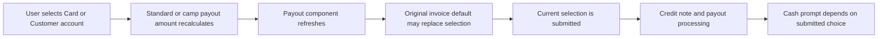

# DEV-77992 Credit clips to selected payback option - Plan

## Goal Capsule

- **Objective:** When a front desk user credits clips from a standard or camp clipcard purchased with cash, the refund follows the Card or Customer account option the user selected, without instructing staff to pay cash.
- **Product authority:** [DEV-77992](https://exerp.atlassian.net/browse/DEV-77992) supplies the reported scenario and expected behavior. The user expanded planning scope to camp clipcards on 2026-10-12. The repository sources below describe the current flow; they do not establish the defect's root cause.
- **Open blockers:** None for planning. The exact point where the selected option is lost or misreported remains an engineering investigation.
- **Means:** Keep an available user-selected payout option through payout amount refreshes, then verify the destination through the existing credit flow (KTD1).

## Product Contract

### Summary

Correct the standard and camp credit clips flows so a cash funded clipcard honors an explicitly selected Card or Customer account payback option across the refund and the information shown to staff.

### Problem Frame

DEV-77992 reports that, in Weekly 874, crediting clips from a clipcard originally purchased with Cash displays “Please give the customer <> from cash register” after Card or Customer account is selected. The report also says the cash register transaction and credit note show the credit clip transaction type as “payout.” No Jira comments or linked pages add detail. The user subsequently included camp clipcards in planning scope. The code inspection has not reproduced or explained the discrepancy in either flow.

### Requirements

**Selected payback**

- R1. For an eligible standard or camp clipcard purchased with Cash, crediting clips with Card selected uses Card as the payback option.
- R2. For an eligible standard or camp clipcard purchased with Cash, crediting clips with Customer account selected uses Customer account as the payback option.

**Staff prompt and records**

- R3. Neither R1 nor R2 displays a prompt directing staff to pay the customer from the cash register.
- R4. The resulting transaction and credit note must reflect the destination actually used for R1 or R2. Planning must verify the existing meaning of the reported “payout” transaction type before deciding whether that label itself is wrong.

### Key Decision

- **Honor the explicit selection.** Governs R1–R4. The Jira acceptance statement names the selected option as authoritative, and the user extended that expectation to camp clipcards. The original cash purchase is a condition for reproducing the bug, not a request to force cash payback.

### Acceptance Examples

- AE1. **Covers R1, R3, R4.** **Given** a clipcard purchased with Cash and clips available to credit, **when** the front desk user credits clips and selects Card, **then** the refund follows Card, no cash register payout prompt appears, and the resulting records reflect that destination.
- AE2. **Covers R2, R3, R4.** **Given** the same original purchase condition, **when** the user selects Customer account, **then** the credit follows Customer account, no cash register payout prompt appears, and the resulting records reflect that destination.
- AE3. **Covers R1, R3, R4.** **Given** eligible camp clipcards purchased with Cash, **when** the user credits the current camp and selects Card, **then** the refund follows Card, no cash register payout prompt appears, and the resulting records reflect that destination.
- AE4. **Covers R2, R3, R4.** **Given** eligible camp clipcards purchased with Cash, **when** the user credits all camps and selects Customer account, **then** the credit follows Customer account, no cash register payout prompt appears, and the resulting records reflect that destination.

### Scope Boundaries

- This plan covers the Person → Membership → Clipcards → Credit clips scenario and the camp refund dialog's current camp and eligible all camps choices.
- Existing camp eligibility, installment account routing, and multi-camp restrictions remain in force. Other original payment methods, split tender, and changes to the amount or buyout fee remain outside the requested behavior change; their existing behavior informs regression checks where the flow is shared.

### Repository Evidence and Planning Questions

- `client/src/main/java/com/exerp/clublead/client/gl/cr/PayoutOption.java` maps Card, Customer account, and Cash to distinct payout targets.
- `client/src/main/java/dk/procard/eclub/subscription/clipcards/BuyoutClipcardController.java` submits the selected payout target and shows the cash prompt only for a Cash target in the single method path, or for a cash allocation in split tender. This conflicts with the reported prompt if Card or Customer account remained selected throughout processing.
- `client/src/main/java/com/exerp/clublead/client/gl/cr/PayoutComponentController.java` can refresh its default selection from the original invoice when payout details change. Whether that happens after the user's choice in the reported sequence is unverified.
- `client/src/main/java/dk/procard/eclub/subscription/clipcards/RefundCampClipcardsController.java` uses the same payout component, recalculates the amount after a target change, and calls `BuyoutClipcardController.refund` for camp or all camps selection.
- `server-core-impl/src/main/java/com/exerp/clublead/server/subscription/SubscriptionServiceBean.java` distinguishes Customer account from other single method payouts. `server-core-impl/src/main/java/com/exerp/clublead/server/subscription/BuyoutClipcardTypeCreatorFactory.java` can resolve the credit note payout target based on the feature flag and clipcard type. Planning must trace the selected target through both paths and compare the prompt and records with an actual reproduction.
- `test-behaviour/src/main/resources/com/exerp/clublead/cucumber/capabilities/clipcard/credit_clipcard.feature` includes existing clipcard credit cases but does not establish the reported cash purchase with Card or Customer account selection.
- `test-behaviour/src/main/resources/com/exerp/clublead/cucumber/capabilities/clipcard/credit_camp_clipcard.feature` covers camp account refunds and a Card refund for camp days bought across cash paid invoices. It also records existing multi-camp and installment constraints; it does not verify the desktop's selected option or cash prompt.

---

## Planning Contract

**Product Contract preservation:** Changed R1–R2 and added AE3–AE4 to include camp clipcards at the user's direction; the wording of R3–R4 is unchanged, and their applicability now includes camp credit through R1–R2.

### Key Technical Decisions

- KTD1. **Preserve an explicit user selection during recalculation.** In the shared payout component, distinguish a user choice from an automatically assigned default. Keep a user choice while it remains enabled; otherwise retain the existing default priority rules. This targets the verified reset path without freezing automatic defaults in other refund flows. Governs R1–R3.
- KTD2. **Keep the server payout mapping intact unless the reproduced records contradict it.** The client submits its current target; `server-core-impl/src/main/java/com/exerp/clublead/server/subscription/SubscriptionServiceBean.java` handles Customer account separately, and `server-core-impl/src/main/java/com/exerp/clublead/server/gl/cr/PayoutCashRegisterTransactionTypeMapper.java` distinguishes cash from card payouts. The reported word “payout” alone does not establish the wrong destination. Governs R4.

### High-Level Technical Design

The current reset path is visible in source but has not been reproduced in a running client:

The planned selection rule is: retain an explicit user choice if it remains enabled; otherwise use the existing initial or fallback default logic. An unavailable choice must not be submitted merely because it was selected earlier. The current model holds the selected value without its provenance, so the implementation must capture whether the change came from the user.

### Sequencing and Risk

First characterize initial defaulting, a change in available defaults, and recalculation after an explicit choice. Then change the shared selection behavior and verify both destinations through the standard and camp clipcard flows. Because the payout component serves other refund screens, check that an option becoming unavailable still falls back to an enabled choice. A financial label change is contingent on evidence that the recorded destination is wrong, not on the generic word “payout.”

### Deferred Implementation Investigation

- Reproduce the original cash purchase and inspect the selected option immediately before submission. The static listener path supports the reset hypothesis, but no runtime result is available yet.
- Reproduce both camp selection modes with cash paid original invoices. Multiple invoices cause the camp dialog to have no single invoice default, so do not assume every camp case exercises the same reset path.
- Check whether the feature flag or buyout fee changes the observed credit note transaction path in the reproduction. Do not broaden the product behavior beyond R1–R4 on that basis alone.

---

## Implementation Units

### U1. Preserve the chosen payout option

- **Goal:** Prevent payout amount refreshes from replacing an explicit Card or Customer account choice with the original invoice's Cash default.
- **Requirements:** R1–R3; AE1–AE4.
- **Dependencies:** None.
- **Files:** `client/src/main/java/com/exerp/clublead/client/gl/cr/PayoutComponentController.java`, `client/src/main/java/com/exerp/clublead/client/gl/cr/PayoutComponentModel.java`, and `client/src/main/java/com/exerp/clublead/client/gl/cr/PayoutComponentView.java` as needed to track user-initiated selection; proposed `client/src/test/java/com/exerp/clublead/client/gl/cr/PayoutSelectionPolicyTest.java` (or the nearest existing client test location if the selection rule stays within the controller).
- **Approach:** Track whether the current selection was made by the user or assigned by defaulting. Keep an enabled user choice during refresh, but let automatic choices follow the existing default priority when availability changes. Isolate the decision from the widget enough to test it without asserting against incidental UI layout.
- **Patterns to follow:** Existing option enumeration in `PayoutComponentView.java` and invoice target resolution in `server-shared/src/main/java/dk/procard/eclub/gl/cr/PayoutTargetResolver.java`.
- **Test scenarios:**
  - Covers AE1. With an invoice containing only a Cash transaction, selecting Card and refreshing the payout amount leaves Card selected.
  - Covers AE2. With that invoice, selecting Customer account and refreshing the payout amount leaves Customer account selected.
  - With a cash-only invoice supplied by the camp dialog, a payout refresh retains an available explicit Card or Customer account choice.
  - With no selection, an enabled Cash option and a cash-only invoice still produce the existing Cash initial default.
  - When an automatically selected Cash default is followed by availability of a higher-priority original split tender option, a refresh applies the existing default priority rather than preserving Cash as if the user chose it.
  - When a selected option becomes disabled before a refresh, it is cleared and an enabled fallback is selected according to the existing rules.
- **Verification:** A valid manual selection survives refresh; initial defaults and invalid-option fallback remain usable.

### U2. Verify the standard clipcard refund outcome

- **Goal:** Prove the selected target reaches the credit flow and that staff see no cash instruction for Card or Customer account.
- **Requirements:** R1–R4; AE1, AE2.
- **Dependencies:** U1.
- **Files:** `client/src/main/java/dk/procard/eclub/subscription/clipcards/BuyoutClipcardController.java` (inspection; change only if U1 does not preserve the submitted option); `test-behaviour/src/main/resources/com/exerp/clublead/cucumber/capabilities/clipcard/credit_clipcard.feature`; `test-behaviour/src/main/java/com/exerp/clublead/cucumber/tests/CreditClipsTest.java` if new behavior steps are needed.
- **Approach:** Extend the existing clipcard credit coverage for a cash-funded original sale and each explicit destination. Check the target used for the credit, the prompt condition, and the resulting destination or transaction type. Treat a generic “payout” label as valid if the target-specific record is correct.
- **Patterns to follow:** Existing Card and Customer account clipcard scenarios in `credit_clipcard.feature`, the facade call steps in `CreditClipsTest.java`, and the cash-only prompt guard in `BuyoutClipcardController.java`.
- **Test scenarios:**
  - Covers AE1. A cash-purchased clipcard credited to Card produces a Card payout record and no instruction to hand over cash.
  - Covers AE2. The same purchase credited to Customer account leaves the credit on that account and shows no cash instruction.
  - A deliberate Cash selection still produces its cash payout instruction and cash-target record.
  - If the chosen Card option becomes unavailable before confirmation, the flow does not silently submit a stale Card target.
- **Verification:** The client selection observed at confirmation matches the submitted target, the recorded destination, and the prompt shown to staff in each scenario.

### U3. Verify the camp clipcard refund outcome

- **Goal:** Prove the camp dialog retains the selected destination and does not prompt staff to pay cash for Card or Customer account.
- **Requirements:** R1–R4; AE3, AE4.
- **Dependencies:** U1.
- **Files:** `client/src/main/java/dk/procard/eclub/subscription/clipcards/RefundCampClipcardsController.java` (inspection; change only if U1 does not preserve the submitted option); `test-behaviour/src/main/resources/com/exerp/clublead/cucumber/capabilities/clipcard/credit_camp_clipcard.feature`; `test-behaviour/src/main/java/com/exerp/clublead/cucumber/tests/CreditCampClipcardsTest.java` if new behavior steps are needed.
- **Approach:** Cover current camp and eligible all camps selections, including a cash paid original invoice that can produce the Cash default and a multiple-invoice case where no single original invoice default exists. Verify the selected target through the shared refund path and the target-specific record. Preserve existing camp eligibility, buyout, and installment rules.
- **Patterns to follow:** Existing camp Card and Customer account scenarios in `credit_camp_clipcard.feature`, the selection and amount listeners in `RefundCampClipcardsController.java`, and the shared submission and prompt logic in `BuyoutClipcardController.refund`.
- **Test scenarios:**
  - Covers AE3. For an eligible cash-purchased current camp with one original invoice, selecting Card before recalculation retains Card and produces a Card destination without a cash prompt.
  - For that current camp, selecting Customer account retains it and credits the customer account without a cash prompt.
  - For eligible all camps credit involving cash paid original invoices, selecting Card yields a Card destination for each payout and no cash prompt, including when invoices differ.
  - Covers AE4. For eligible all camps credit involving cash paid original invoices, selecting Customer account credits the appropriate account and shows no cash prompt.
  - An ineligible multi-camp or installment case continues to follow its existing restriction or account routing rather than using this change to bypass it.
- **Verification:** In each eligible camp mode, the choice at confirmation matches the submitted target and records; prompt verification uses a client-level or manual check when the behavior scenario cannot observe the dialog.

---

## Verification Contract

- Run the focused client selection tests and affected standard and camp clipcard behavior scenarios with the repository's approved test runner. This planning pass did not execute them.
- Reproduce the Weekly 874 steps in a suitable front desk environment with cash-purchased standard and camp clipcards. Select Card and Customer account in separate runs for the standard dialog, current camp, and eligible all camps choices, inspecting the selected option before confirmation, the cash prompt, the cash register transaction type, and the credit note destination.
- Check one intentional Cash payback and an unavailable-option fallback to detect regressions in the shared payout component.
- If a behavior scenario cannot observe the desktop prompt, keep prompt verification in a client-level test or manual evidence and do not claim the server scenario proves it.

---

## Definition of Done

- R1–R4 and AE1–AE4 are supported by focused tests and front desk reproduction for standard and camp flows; any remaining environment limitation is reported with the unverified behavior named.
- The change preserves default selection, unavailable-option handling, and deliberate Cash payout behavior.
- Financial records are changed only if target-specific evidence shows they are wrong; unrelated cleanup and abandoned attempts are absent from the diff.

---

### 🧠 Engineering Decision Log

1. **What was the hardest decision you made here?** Whether to name a client selection reset as the defect. The UI's cash prompt guard and server's target handling make that plausible, but the reported outcome conflicts with the visible guard and no reproduction was available. The plan therefore specifies observable payback and record behavior while leaving the cause to a trace of the actual flow.
2. **What alternatives were rejected?** A prompt only correction was rejected because Jira also reports suspect cash register and credit note records and explicitly requires the selected payback option to be used. A forced cash refund based on the original purchase was rejected because it contradicts the Jira acceptance statement for Card and Customer account.
3. **What is the fatal flaw?** If “payout” in the reported records is a generic transaction category rather than evidence of a cash destination, changing that label could misrepresent legitimate accounting. Planning must verify the precise meaning of those record fields against the reproduced transaction and existing rules.
